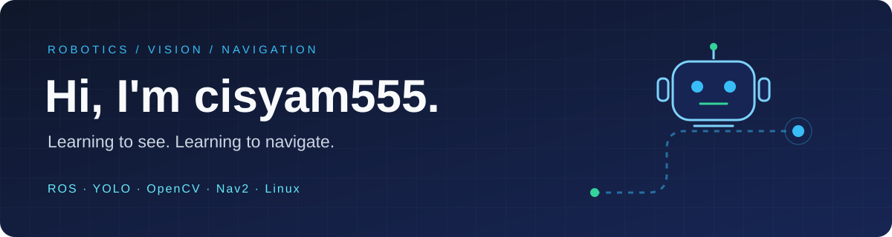

### 👋 你好，我是 cisyam555

**一名正在学习 ROS 的大学生 · 在代码与机器人之间，探索更多可能**

让机器人看懂世界，也找到自己的方向。

---

### 🧑‍💻 关于我

- 🎓 在校大学生，正在学习 **ROS 与机器人开发**。
- 👁️ 学习 **YOLO、OpenCV**，探索目标检测与视觉交互。
- 🧭 学习 **Nav2**，逐步理解机器人的定位、路径规划与导航。
- 🐧 在 **Linux** 环境下练习开发，用 **Git** 记录迭代，用 **Shell / Python** 把想法变成程序。
- 🌱 喜欢从小实验开始，在调试、记录和复盘中积累经验。

### 🛠️ 正在学习的技术栈

**机器人与视觉**

**编程与开发工具**

### 🚀 项目实践

| 项目 | 内容 | 相关技术 |
| :--- | :--- | :--- |
| [🖐️ OpenCV 手势鼠标](https://github.com/cisyam555/opencv-gesture-mouse) | 利用摄像头识别手部关键点，实现鼠标移动、点击、拖拽与滚动 | Python · OpenCV · MediaPipe · Linux |

### 🗺️ 我的学习路线

| 方向 | 练习内容 |
| :--- | :--- |
| 🐧 开发基础 | Linux 常用命令、Git 版本管理、Shell 自动化、Python 编程 |
| 👁️ 计算机视觉 | OpenCV 图像处理、摄像头采集、YOLO 目标检测 |
| 🤖 ROS | 节点通信、话题与服务、坐标变换、机器人仿真 |
| 🧭 Nav2 | 地图与定位、路径规划、避障与导航实践 |
| 🔗 综合实践 | 尝试把视觉感知与机器人导航连接起来 |

### 🌱 接下来想做

- [ ] 整理 ROS 学习笔记与基础示例。
- [ ] 完成一个 YOLO 摄像头目标检测小实验。
- [ ] 跑通 Nav2 仿真导航，并记录配置与调试过程。
- [ ] 探索视觉识别与 ROS 节点通信的结合。

---

**Learn · Build · Debug · Repeat**

一步一步积累，让每一次运行都更接近想象。

